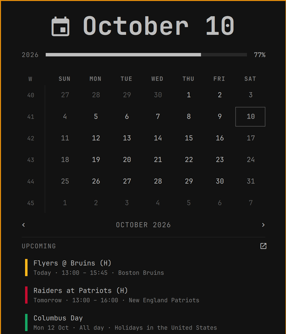

# renCal Clock

An [Omarchy](https://omarchy.org) bar clock whose calendar popup also lists your
upcoming [renCal](https://github.com/t4t5/rencal) events, with one-click
**Join** buttons for video calls.



It is Omarchy's own clock widget (same label, formats, month grid and year
progress), with an **Upcoming** section added under the grid:

- The next events from every renCal calendar, soonest first, each with its
  calendar colour, time and calendar name. Recurring events are expanded, so a
  weekly meeting shows its next occurrence.
- Click an event to open it in renCal (via its `rencal://event` deep link).
- Events with a Google Meet, Zoom, Microsoft Teams, Webex, Jitsi, Whereby or
  Proton Meet link get a **Join** button. It turns accent-coloured from ten
  minutes before the start until the meeting ends, the same window renCal uses.
- The list refreshes when the popup opens and every minute while it is open.

## Requirements

- [renCal](https://github.com/t4t5/rencal) (AUR: `rencal-bin`) with at least one
  calendar connected. Events are read straight from its caldir `.ics` files
  (`~/caldir` unless `~/.config/caldir/config.toml` sets `calendar_dir`).
- Two Python packages for parsing and recurrence expansion:

  ```bash
  sudo pacman -S python-icalendar python-recurring-ical-events
  ```

  Until they are installed, the popup says so instead of listing events.

## Install

```bash
omarchy plugin add https://github.com/jmb11111/omarchy-rencal-clock --enable
```

The plugin replaces the stock `omarchy.clock` in place and keeps its settings
(label format etc.). Anything that already talks to `omarchy.clock` over IPC,
such as `omarchy-shell omarchy.clock toggle` or a keybinding, keeps working.

## Using it

| Action | Result |
|--------|--------|
| Left click the clock | Open the popup |
| Right click | Cycle the label format |
| Middle click | Timezone picker |
| Click an event | Open it in renCal |
| **Join** | Open the meeting link |
| `j` | Join the meeting that is on now or about to start |
| `o` | Open renCal |
| `[` `]` / `{` `}` / `t` / `w` | Previous/next month, previous/next year, today, toggle week start |

## Settings

Set these on the widget's entry in `~/.config/omarchy/shell.json` or in the
Omarchy settings panel:

| Key | Default | Description |
|-----|---------|-------------|
| `daysAhead` | `7` | How many days ahead the Upcoming list looks (1–60) |
| `maxEvents` | `8` | Maximum events shown (1–30) |
| `hideWorkingLocation` | `true` | Hide Google Calendar's all-day "Home" / "Office" working-location entries |
| `format`, `formatAlt`, `verticalFormat`, `verticalFormatAlt`, `weekStartDay` | | Same as the stock Omarchy clock |

## Credits

Based on the clock widget from [Omarchy](https://github.com/basecamp/omarchy)
(MIT). Meeting-link detection mirrors renCal's own.
